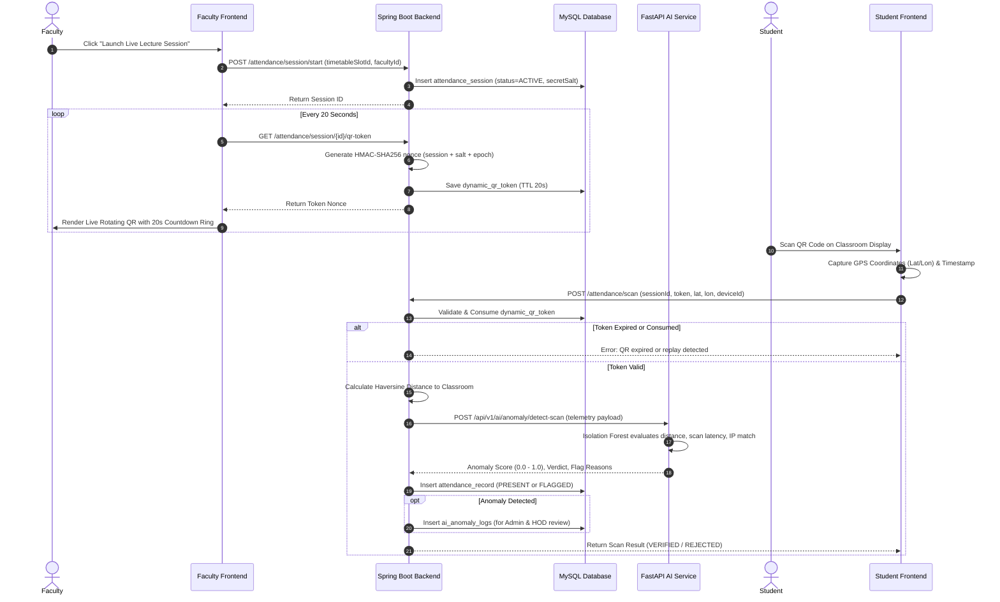

# ATTENDX CAMPUS 2026: System Architecture Specification
## An AI-Powered Smart Attendance and Academic Monitoring System

### 1. Architectural Overview
ATTENDX CAMPUS 2026 is designed as a high-performance modular multi-service system comprising:
1. **Presentation Layer (React 18 + TypeScript + Vite + Tailwind CSS)**:
   - Client-side Single Page Application (SPA).
   - Reactive Campus Clock listener synchronizing with India Standard Time.
   - Dynamic QR rendering engine with SVG countdown bars.
   - Client-side telemetry capture (GPS coordinates, timestamp delta, device fingerprints).
2. **Business & Transactional Layer (Java 21 + Spring Boot 3)**:
   - RESTful API endpoints secured by stateless JWT tokens.
   - Timetable period schedule evaluator & substitute calendar coordinator.
   - Dynamic QR token minter with cryptographic HMAC-SHA256 nonces.
   - Spring Data JPA with MySQL 8.0 relational persistence.
3. **Machine Learning & AI Engine (Python 3.14 + FastAPI + scikit-learn)**:
   - Isolation Forest model for zero-day proxy scan anomaly detection.
   - Random Forest model for semester attendance trajectory and shortage risk prediction.
   - Feature engineering pipeline parsing classroom geo-fences and student velocity.
4. **Data & Storage Layer**:
   - MySQL 8.0 with InnoDB ACID compliance.
   - Flyway automated schema migrations.

```
+-----------------------------------------------------------------------------------------+
|                                    CLIENT LAYER                                         |
|  [Student Portal]       [Faculty Console]       [HOD Dashboard]       [Admin Room]     |
|         |                      |                      |                     |           |
|         +----------------------+----------------------+---------------------+           |
|                                | HTTP/REST + TLS                                        |
+--------------------------------v--------------------------------------------------------+
                                 |
+--------------------------------v--------------------------------------------------------+
|                               BACKEND CORE (SPRING BOOT 3)                              |
|  [Security / JWT]   [Timetable Engine]   [QR Token Minter]   [Academic Calendar]       |
|  [Attendance Svc]   [Leave Approvals]    [Dispute Manager]   [Audit Log Service]       |
+--------------------------------+----------------------+---------------------------------+
                                 |                      |
             +-------------------+                      +-------------------+
             | REST Internal (Port 8000)                                    | JDBC (Port 3306)
+------------v------------------------------+   +---------------------------v-------------+
|    AI & ML SERVICE (PYTHON + FASTAPI)     |   |          MYSQL 8.0 RELATIONAL DB        |
|  [Isolation Forest Anomaly Detector]      |   |  departments, users, students, faculty  |
|  [Random Forest Shortage Risk Forecaster] |   |  subjects, classrooms, timetable_slots  |
|  [Feature Extractor & Geo-Fence Evaluator]|   |  attendance_sessions, dynamic_qr_tokens |
|  [Model Weights & Evaluation Metrics]     |   |  attendance_records, ai_anomaly_logs    |
+-------------------------------------------+   +-----------------------------------------+
```

---

### 2. Sequence Diagram: Dynamic QR Generation & Verification Flow



---

### 3. Anti-Proxy Security Architecture
1. **Replay Attack Defense**: Dynamic QR tokens expire every 20 seconds. Once consumed by a student, the nonce is flagged as `is_consumed = TRUE`, preventing students from sharing screenshots via WhatsApp or Telegram.
2. **Geo-Fencing Perimeter**: Classroom coordinates are stored in MySQL with predefined radius meters (e.g. 30m). Scans outside the boundary trigger immediate AI flags.
3. **Behavioral AI (Isolation Forest)**:
   - Scans submitted with $< 0.35$s latency indicate automated token relays/bots.
   - IP subnet validation flags cellular hotspot connections from outside campus Wi-Fi.
